# Auditoria de confiabilidade documental — Repassafe

Data de referência: 08/10/2026 · Tipo: diagnóstico estático (somente leitura)
Documentos irmãos: [matriz-conformidade.md](matriz-conformidade.md) · [plano-adequacao.md](plano-adequacao.md)

## 0. Método e limites desta auditoria

- Inspeção estática do repositório local (código, migrations, testes pgTAP/Vitest/Playwright, ADRs e documentos
  operacionais). Nenhuma migração foi executada, nenhum dado real foi lido, nenhum segredo foi aberto.
- **Nenhum teste foi reexecutado nesta auditoria.** Resultados de testes citados vêm dos relatórios do próprio
  projeto (p.ex. `docs/reviews/external-agreement-implementation-2026-10-07.md`) e valem como _declarados_, não
  como _verificados por mim_.
- Painéis do Supabase/Vercel (criptografia em repouso, PITR, configurações de Auth, retenção de logs, estado das
  migrations remotas) **não foram inspecionados** → marcados NÃO VERIFICADO.
- As normas do §3 foram conferidas na Etapa 0 (08/10/2026), exceto a LGPD — ver
  [conferencia-normas-2026-10-08.md](conferencia-normas-2026-10-08.md). Nada aqui é conclusão jurídica;
  recomendações jurídicas dependem de parecer humano.
- Há alterações locais não commitadas (git status), incluindo todo o subsistema "acordo externo". A auditoria
  descreve o que está no working tree, não só o que está em `main`.

## A. Resumo executivo

O Repassafe já tem **uma base de persistência melhor do que a média** para um MVP, mas **não possui camada de
assinatura nem de verificabilidade independente**, e a **formação do contrato é frágil em um dos dois fluxos**.

| Camada | Maturidade | Síntese |
| --- | --- | --- |
| Persistência | **Boa** | Tabelas de documento/evento imutáveis por trigger, RLS com `revoke` explícito, cadeia SHA-256 de eventos, RPCs idempotentes e transacionais, comprovantes em bucket privado sem política de UPDATE/DELETE. |
| Formação do contrato | **Média** | Fluxo "acordo externo" vincula o aceite ao `terms_hash`; o fluxo de grupo/oferta livre não vincula o aceite a uma versão no momento do consentimento. Não há negociação, versões, aditivos nem texto renderizado preservado. |
| Assinatura / identidade | **Fraca** | Aceite = ação autenticada (e-mail confirmado + senha). MFA só para admin. Sem provedor de assinatura, sem reautenticação no aceite, sem IP/dispositivo. |
| Evidência / exportação / verificação externa | **Ausente** | Só "Imprimir ou salvar como PDF" pelo navegador; verificação roda no servidor do próprio Repassafe com dados do próprio banco; sem PDF final, manifesto, dossiê ou âncora de tempo. |

**Resposta à pergunta central — onde intervir?** Em **três camadas, em intensidades diferentes**:

1. **Persistência:** ajustes pontuais (endurecer, testar, ampliar backup). _Não reescrever._
2. **Formação:** intervenção moderada (vincular aceite à versão no fluxo A, preservar texto renderizado,
   estruturar vencimento, criar aditivos/versões).
3. **Assinatura e evidência:** construção nova (âncora de tempo/assinatura de provedor, artefato PDF, dossiê
   verificável fora do app). É aqui que está a maior distância até a especificação.

Em termos probatórios, hoje os registros são **indícios organizados e com detecção de alteração interna**
(_tamper-evidence_ dentro do domínio de confiança do próprio Repassafe). O próprio projeto já declara isso
(`docs/operations/agreement-evidence-dossier.md`, telas `/acordos/[id]` e `/acordos/registrados/[id]`). Não há,
hoje, base técnica para chamar o resultado de "assinado" ou "verificável por terceiros".

**Escopo de partes (decidido em 08/10/2026, [ADR-011](adr/ADR-011-escopo-de-partes.md)):** o produto é **repasse
entre médicos** (titular ↔ substituto), com instituição/grupo como contexto. Pessoas jurídicas como contratantes
ficam **fora por ora**; representação (AUT-006) deixou de ser lacuna.

## B. Arquitetura encontrada

| Item | Achado | Evidência |
| --- | --- | --- |
| Frontend/backend | Next.js 16.3.6 (App Router, Server Actions), React 19.2, TypeScript, Zod 4 | `package.json`; `src/app/**` |
| Banco / Auth / Storage | Supabase (PostgreSQL + Auth + Storage), RLS, RPCs `security definer`, `pgcrypto` | `supabase/migrations/*`; `src/lib/supabase/*` |
| Hospedagem | Vercel (preview/produção) + Supabase | `docs/operations/environments.md` |
| Ambientes | dev e **staging** (`us-east-2`) provisionados; **produção não provisionada** | `docs/operations/environments.md` |
| Provedor de assinatura | **Nenhum** (sem SDK/integração; "assinatura" só aparece em avisos) | `package.json`; grep em `src` |
| Autenticação | E-mail/senha, e-mail confirmado; MFA TOTP exigido só a admin (`aal2`) | `src/lib/auth/require-admin-mfa.ts`; `supabase/config.toml` |
| Service role | Usado em páginas/ações de admin, métricas, limpeza de comprovante, rate limit | `src/lib/supabase/admin.ts` (+9 usos) |
| CI | GitHub Actions: `pnpm check` (format, tipos, lint, Vitest, escopo, segredos, `pnpm audit`), Playwright, `supabase test db`, lint e advisors | `.github/workflows/ci.yml` |
| Observabilidade | Logger próprio; `/api/health`, `/api/ready`; métricas piloto | `src/lib/observability/logger.ts`; `docs/operations/monitoring.md` |
| Backup | Script lógico PowerShell; restauração validada em contêiner (30/09); **sem Auth/Storage** | `docs/operations/backup-restore*.md` |
| Documentos | Sem PDF no servidor; impressão pelo navegador | `src/app/acordos/**`, `print-document-button.tsx` |

### B.1 Dois subsistemas de acordo (não há máquina de estados única)

| | **Fluxo A — oferta de grupo / livre** | **Fluxo B — "Registrar acordo" (externo)** |
| --- | --- | --- |
| Origem | Oferta publicada → candidatura → seleção → confirmação | Convite direto por e-mail, iniciado por qualquer parte |
| Tabelas | `shift_offers`, `shift_applications`, `substitutions`, `shift_agreements`, `workflow_commands` | `external_agreements`, `external_agreement_events`, `private.external_agreement_requests` |
| Documento | `agreement_documents` (JSON canônico + texto + SHA-256) | `external_agreements.document_text/document_hash` |
| Eventos | `agreement_evidence_events` (4 tipos) + `audit_events` | `external_agreement_events` (9 tipos) + `audit_events` |
| Estados | `substitution_status`: pending_substitute_confirmation → pending_institutional_approval → confirmed / rejected_institutionally / cancelled | `pending_acceptance` → `pending_approval` → `confirmed` / declined / rejected / cancelled (+ `expired` derivado do horário) |
| Imutabilidade | `shift_agreements_immutable`, `agreement_*_immutable` | `external_guard` (condições, documento, eventos) |
| Execução do serviço | `shift_completions` (reporta um lado, confirma o outro) + `shift_occurrences` | **Não há** (só pagamento informado / recebimento confirmado) |
| Migração | Em `main` | **Não commitada**; aplicada só no banco local |

Estados sugeridos na especificação × equivalentes existentes: `DRAFT` — inexistente (criação já é envio);
`PENDING_REVIEW` ≈ `pending_acceptance` / `pending_substitute_confirmation`; `CHANGES_REQUESTED` — inexistente
(só recusar); `PENDING_SIGNATURES` ≈ `pending_approval` (aprovação institucional, não assinatura);
`FORMALIZED` ≈ `confirmed`; `CANCELLED` ≈ cancelled/declined/rejected/expirado; `SUPERSEDED` — inexistente.
**Recomendação:** não renomear; acrescentar `CHANGES_REQUESTED`/`SUPERSEDED` somente junto com versões/aditivos.

### B.2 Fluxo de contratação reconstruído

```mermaid
flowchart TD
  subgraph B[Fluxo B - acordo externo]
    B1[Parte A cria + aceita<br/>terms_hash gravado] --> B2[Convite por e-mail<br/>WhatsApp = link]
    B2 --> B3{Parte B autenticada,<br/>e-mail confere?}
    B3 -- recusa --> B4[declined]
    B3 -- aceita com terms_hash --> B5{grupo exige aprovação?}
    B5 -- não --> B6[confirmed + snapshot + SHA-256]
    B5 -- sim --> B7[pending_approval] --> B6
    B1 -. cancelar .-> B8[cancelled]
    B6 --> B9[pagamento informado] --> B10[recebimento confirmado / divergência]
  end
  subgraph A[Fluxo A - oferta]
    A1[Titular publica + confirma termos] --> A2[Candidaturas] --> A3[Titular seleciona<br/>exige ack mais recente que updated_at]
    A3 --> A4[Substituto confirma em 30 min<br/>terms_acknowledged]
    A4 --> A5{aprovação?}
    A5 -- sim --> A6[Aprovador decide] --> A7
    A5 -- não --> A7[shift_agreements snapshot<br/>+ documento + cadeia]
    A7 --> A8[conclusão reportada por um lado<br/>e confirmada pelo outro]
  end
```

Respostas às 16 perguntas do §5.2 (✔ existe · ◐ parcial · ✘ ausente · ? não verificado):

| # | Pergunta | A | B |
| --- | --- | --- | --- |
| 1 | Quem inicia | ✔ titular | ✔ qualquer parte |
| 2 | Dados obrigatórios | ◐ setor, horário, valor, pagamento (texto livre) | ✔ + local, vencimento, forma de pagamento |
| 3 | Identificação | ◐ UUID + nome de exibição | ✔ + CRM/UF/status (`external_person`) |
| 4 | Compartilhamento | ✔ oferta no grupo | ✔ convite por e-mail confirmado |
| 5 | Contraparte revisa | ? tela de confirmação não auditada em detalhe | ✔ resumo antes do aceite |
| 6 | Negociação/alteração | ✘ (editar só antes da 1ª candidatura) | ✘ (recusar; corrigir = novo convite, sem vínculo) |
| 7 | Aceite | ◐ flag `terms_acknowledged` | ✔ flag + `terms_hash` |
| 8 | Assinatura eletrônica | ✘ | ✘ |
| 9 | Aceite ligado à versão final | ◐ ligado _a posteriori_ | ✔ |
| 10 | Alterável após aceite | ✘ bloqueado por trigger (RLS+trigger) | ◐ condições bloqueadas; `status`/`received_at` editáveis por papel privilegiado |
| 11 | Armazenamento | ✔ Postgres | ✔ Postgres + Storage (comprovantes) |
| 12 | Cópia de cada parte | ◐ página/impressão | ◐ página/impressão |
| 13 | Cancelamento | ✔ antes da confirmação | ✔ antes da confirmação; após confirmar, só divergência |
| 14 | Aditivos | ✘ | ✘ |
| 15 | Registro da realização | ✔ `shift_completions` bilateral | ✘ |
| 16 | Exportação | ✘ (imprimir) | ✘ (imprimir) |

## C. Funcionalidades já implementadas (com evidência)

| Controle | Evidência |
| --- | --- |
| Documento e eventos do acordo append-only | Triggers `agreement_documents_immutable`, `agreement_evidence_events_immutable`, `shift_agreements_immutable` (`20260924153352…sql`, `20260923000759…sql`) |
| Cadeia SHA-256 por acordo, serializada por `FOR UPDATE` | `private.append_agreement_evidence` (fluxo A); `external_command` + `unique(agreement_id, sequence)` (fluxo B) |
| Hash do documento + texto canônico exato guardados | `agreement_documents.canonical_content_text/document_sha256`; `external_agreements.document_text/document_hash` |
| Aceite ligado ao conteúdo exato (B) | `external_command`: `input->>'terms_hash' is distinct from a.terms_hash → exception`; pgTAP "acceptance binds exact terms" |
| Condições imutáveis após envio (B) | `external_guard`; pgTAP "even privileged accidental edits cannot change deadline" |
| Idempotência por (ator, request_id) com fingerprint | `private.external_agreement_requests`; pgTAP "create retry is idempotent", "same request cannot mutate content" |
| Autorização por recurso | Políticas `external agreement audiences`, `agreement parties and approvers read…`; `security_rls_matrix.sql`; pgTAP "forwarded invite reveals nothing to outsider" |
| Convite vinculado a e-mail confirmado (link encaminhado não basta) | `external_can_read`, `external_command` (`my_email<>a.recipient_email`) |
| Separação identidade × habilitação × vínculo × admin | `external_eligible`, `independent_administrative_access`, `docs/product/registration-full-spec-review.md` |
| Pagamento informado ≠ recebimento confirmado ≠ divergência | `external_command` ops `payment`/`receive`/`dispute`; pgTAP |
| Comprovante privado, sem UPDATE/DELETE por cliente; nome carrega SHA-256 do arquivo | Políticas de `storage.objects`; `actions.ts` (`upsert:false`, digest no caminho) |
| Execução do serviço separada do contrato (A) | `shift_completions` (reporta/confirma), `shift_occurrences` |
| Linguagem prudente | Telas dizem "não é assinatura digital qualificada"; nenhuma ocorrência de "garantido/blindado/título executivo" em `src` |
| Aceite de termos/privacidade com hash do conteúdo | `private.legal_acceptances.content_hash` |
| Rate limit e auditoria de segurança | `20260923003100…sql`; `src/lib/security/*` |

## D. Funcionalidades parcialmente implementadas

1. **Aceite do substituto no fluxo A não carrega hash.** O documento canônico é gerado _depois_ do aceite
   (`create_agreement_dossier` é `AFTER INSERT` em `shift_agreements`; o evento `substitute_accepted` é
   recriado retroativamente a partir de `audit_events`). A ligação aceite↔versão é inferida pela
   impossibilidade de editar a oferta após candidaturas, não provada por hash no momento do consentimento.
2. **Documento canônico é dado estruturado, não o texto que o usuário viu.** Não há `template_version` nem o
   texto renderizado; mudanças de redação na UI alteram o que "foi visto" sem rastro. No fluxo A o `snapshot`
   omite `notes` (observações da oferta); verificar se são exibidas ao substituto antes do aceite.
3. **Verificação é interna.** `verifyAgreementEvidence` (`src/lib/agreements.ts`) e `verifyEventChain`
   (`/acordos/[id]`) rodam no servidor do Repassafe lendo o banco do Repassafe. Detectam divergência
   _texto↔hash↔cadeia_, mas quem controla o banco pode reescrever texto, hash e cadeia de forma coerente.
4. **Imutabilidade é por trigger.** Papéis com privilégio (owner da tabela, superusuário, `service_role` com
   `grant all`) podem desativar triggers, executar `TRUNCATE` (nenhum gatilho cobre) e, no fluxo B,
   alterar `status`/`received_at` de acordo confirmado (a `external_guard` exclui esses campos da comparação).
5. **Tempo.** Relógio do banco (`now()`/`clock_timestamp()`, `timestamptz`) — adequado como relógio de servidor,
   sem carimbo do tempo independente.
6. **Fidelidade de pagamento no fluxo A.** `payment_terms` é texto livre (2–300 caracteres), sem vencimento
   estruturado; o fluxo B resolveu isso com `due_date`/`payment_method`.
7. **Identificação.** Dados civis (nome, CPF, nascimento, CRM) existem e passam por análise administrativa, mas o
   documento do acordo traz só nome/UUID (A) ou nome/CRM/UF/status (B), e o aceite não exige reautenticação.
8. **Falhas.** Operações rejeitadas lançam exceção → _rollback_ → **não deixam rastro** na cadeia do acordo.
9. **Backup.** Lógico e validado, mas fora do Storage/Auth e dependente de operador (ver G).

## E. Funcionalidades ausentes

Provedor de assinatura e evidências do provedor · carimbo de tempo independente · reautenticação/MFA no aceite
· captura de IP/dispositivo (decisão adiada, corretamente, até base legal) · versões e
pedido de alteração · aditivos · PDF final preservado com hash próprio · relatório de assinaturas · dossiê/
manifesto/instruções de verificação · verificador externo · log de leitura de documentos/comprovantes ·
política de retenção/descarte · registro de tentativas rejeitadas · confirmação de execução no fluxo B ·
backup do Storage e do Auth · testes de adulteração de bytes, de dossiê e de recuperação.

## G. Riscos jurídicos, técnicos e operacionais

Escala: P = probabilidade, I = impacto, E = exposição (B/M/A). Controles: **Pr**eventivo, **De**tectivo, **Co**rretivo.

| # | Cenário | P | I | E | Situação atual | Controle recomendado |
| --- | --- | --- | --- | --- | --- | --- |
| R1 | Contratante nega ter aceito | M | A | **A** | Aceite autenticado + eventos; sem step-up, sem provedor, sem IP/UA | Pr: reauth/MFA no aceite + provedor; De: evidência de método (aal/amr); Co: dossiê exportável |
| R2 | Médico nega alteração | B | M | M | B protegido por `terms_hash`; A inferido | Pr: aceite com hash (A); De: cadeia; Co: texto renderizado preservado |
| R3 | PDF modificado | M | A | **A** | Não há PDF guardado; impressão local não tem hash | Pr: PDF no servidor + SHA-256; De: manifesto; Co: re-emissão a partir do canônico |
| R4 | Contrato sobrescrito | B | A | M | Triggers + RLS; privilégio alto contorna | Pr: revogar UPDATE/DELETE/TRUNCATE de `service_role`; De: âncora externa; Co: backup/PITR |
| R5 | Acesso a contrato de terceiro (IDOR) | B | A | M | RLS testada; rota de comprovante usa cliente do usuário | Pr: manter matriz de testes; De: log de leitura |
| R6 | Admin altera documento | B | A | **A** | Sem segregação técnica para quem tem banco/`service_role`; admin da app exige MFA | Pr: papéis de banco mínimos; De: âncora externa + checagem periódica; Co: restauração por PITR |
| R7 | Webhook falso | — | — | — | **N/A hoje** (sem provedor) | Pr: validar assinatura HMAC + janela de tempo ao integrar |
| R8 | Evento repetido | B | M | B | Idempotência por request_id (B) | Manter; replicar no webhook |
| R9 | Exclusão indevida | B | A | M | Sem DELETE para clientes; sem política de retenção; FKs sem cascade protegem; backup sem Storage | Pr: política + papel sem DELETE; Co: backup Storage + PITR |
| R10 | Serviço não realizado | M | A | **A** | A: bilateral; B: nada (acordo não afirma execução) | Pr: execução opcional bilateral no B; manter rótulos "declarado/confirmado" |
| R11 | Representante sem poderes | — | — | — | **N/A** (PJ fora de escopo, ADR-011) | Reabrir se os gatilhos da ADR ocorrerem |
| R12 | Plataforma indisponível | M | M | M | Sem exportação; RPO 24 h; produção inexistente | Dossiê exportável; PITR; runbook |
| R13 | Dados de saúde em texto livre | M | A | **A** | `notes`, `payment_terms`, `dispute.description` livres; só proibição nos Termos | Aviso no campo + detecção simples + política |
| R14 | Dependência de migração não promovida | A | M | **A** | Migração externa só no banco local; migração `20261001…` ausente do histórico local | Reconciliar histórico e promover a staging antes de qualquer uso real |
| R15 | Região do banco fora do Brasil | M | M | M | dev/staging `us-east-2`; produção "preferencialmente sa-east-1" | Decidir região e base legal de transferência (LGPD) |

## Inventário de testes relevantes

| Alvo | Existe | Observação |
| --- | --- | --- |
| RLS / acesso indevido | `supabase/tests/security_rls_matrix.sql`, `external_agreements.sql`, `rls.sql` | Boa cobertura declarada |
| Imutabilidade B | `external_agreements.sql` | UPDATE de condições e DELETE de eventos |
| Imutabilidade `shift_agreements` | `mvp_acceptance_flow.sql` (~l. 295) | Só o snapshot |
| Imutabilidade `agreement_documents`/`agreement_evidence_events` | **Não encontrado** | Gap |
| Cadeia/hash B | `external_agreements.sql` | Verifica contiguidade e hashes via SQL |
| `verifyAgreementEvidence` / `verifyEventChain` com dados adulterados | **Não encontrado** | Gap (TC-002) |
| Idempotência | `external_agreements.sql` | Sem teste de concorrência real (declarado no relatório) |
| E2E do fluxo B | `tests/e2e/external-agreements.spec.ts` | Roda só com `RUN_EXTERNAL_AGREEMENT_E2E=1` |
| Recuperação | `backup-restore-validation-2026-09-30.md` | Sem Auth/Storage |

## Conclusão

Intervir em **persistência (leve)**, **formação (moderada)** e **assinatura/evidência (nova)**. O investimento
já feito no banco deve ser preservado; o desvio de maior risco é _tratar a cadeia interna como prova
independente_. Próximos passos e decisões: [plano-adequacao.md](plano-adequacao.md).
